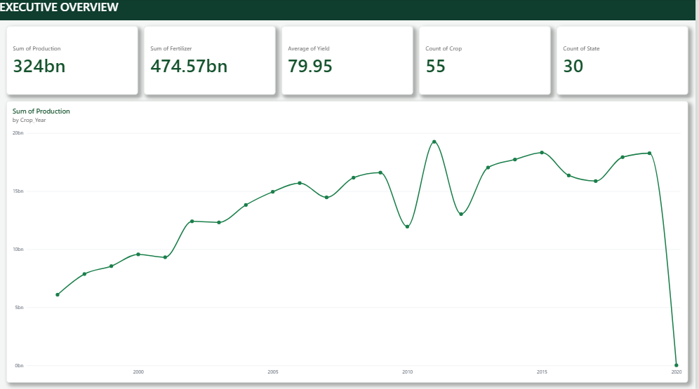
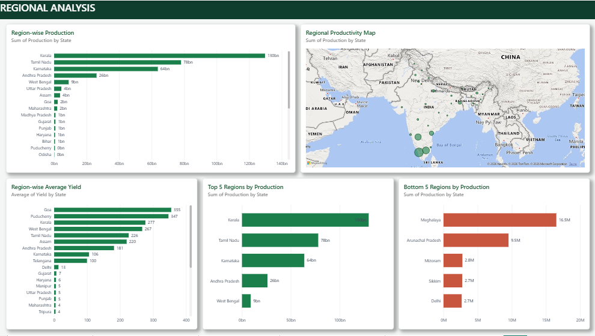

# Agriculture Crop Production Analytics

Project Overview

Agriculture Crop Production Analytics is a data analytics project developed using Microsoft Power BI. It explores crop production, yield, seasonal performance, and regional agricultural trends to support data-driven understanding of crop productivity.

Objectives

- Analyze crop production trends over different years.
- Compare crop yield across states and seasons.
- Study fertilizer and pesticide usage.
- Understand regional differences in agricultural productivity.
- Present insights through interactive dashboards.

Tools and Technologies

- Microsoft Power BI
- Power Query
- DAX (Data Analysis Expressions)
- Data Visualization

Dashboard Pages

- Executive Overview
- Crop and Seasonal Analysis
- Regional Analysis
- Fertilizer vs. Yield Analysis
- Recommendations

Dataset

The dataset contains crop, year, season, state, area, production, annual rainfall, fertilizer, pesticide, and yield-related fields.

Key Insights

Add 3–5 findings based on the actual charts and values in your Power BI report.

How to View the Project

1. Download the ".pbix" file from this repository.
2. Open it using Microsoft Power BI Desktop.
3. Explore the report pages and filters.

Author

Kailash Kumar M.

Project Domain

Data Analytics | Business Intelligence
## Dashboard Preview

## KEY FINDINGS

